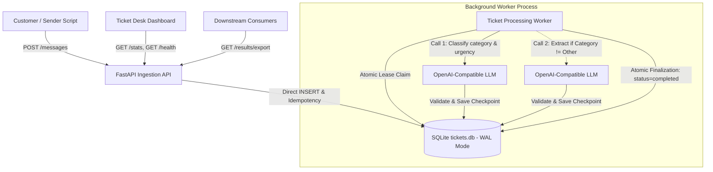

Ticket Desk

A reliable, modular, production-minded ticket processing backend that ingests customer support messages, extracts relevant entities, classifies issues with strict business logic via an LLM, and exposes operational controls and export APIs.

---

## 1. Architecture Overview

The system decouples ingestion from LLM processing via SQLite as a durable work queue:



---

## 2. Prerequisites

- **macOS / Linux**
- **Python 3.12**
- **`uv` package manager** (installed via `curl -LsSf https://astral.sh/uv/install.sh` or `brew install uv`)

---

## 3. Setup and Installation

All dependencies and environment configurations are managed via `uv` in the `backend/` directory:

```bash
cd backend

# Create virtual environment and sync dependencies
uv sync

# Configure environment variables
cp .env.example .env
```

---

## 4. Environment Configuration

Edit `backend/.env` as needed:

| Variable | Description | Default |
|---|---|---|
| `DATABASE_PATH` | Path to the SQLite database file | `data/tickets.db` |
| `LLM_BASE_URL` | Base URL of OpenAI-compatible LLM endpoint | `https://your-llm-host.ngrok-free.app/v1` |
| `LLM_API_KEY` | API Key for LLM service (optional) | *(empty)* |
| `LLM_MODEL` | Model identifier | `qwen3-4b` |
| `LLM_TIMEOUT_SECONDS` | Request timeout for LLM calls | `30` |
| `MAX_ATTEMPTS` | Maximum failed processing attempts before permanent failure | `3` |
| `MAX_MESSAGE_LENGTH` | Maximum accepted character length for customer messages | `5000` |
| `CLAIM_TIMEOUT_SECONDS` | Lease duration before recovering stale `processing` jobs | `60` |
| `RETRY_BACKOFF_BASE` | Base multiplier for exponential backoff ($base^{attempts}$) | `2.0` |
| `WORKER_POLL_INTERVAL` | Polling idle interval in seconds for background worker | `1.0` |

---

## 5. How to Run

### Option A: One-Command Cross-Platform Startup (Recommended)
You can launch both the FastAPI backend (with the integrated Ticket Desk UI) and the background worker simultaneously using the cross-platform runner:

- **macOS / Linux**:
  ```bash
  python3 run.py
  # or: ./run.sh
  ```
- **Windows**:
  ```cmd
  python run.py
  # or double-click run.bat
  ```

Once running, access:
- **Operations Screen (UI)**: [http://127.0.0.1:8000/](http://127.0.0.1:8000/)
- **Interactive OpenAPI Docs**: [http://127.0.0.1:8000/docs](http://127.0.0.1:8000/docs)
- **Health Check**: [http://127.0.0.1:8000/health](http://127.0.0.1:8000/health)

Press `Ctrl+C` to cleanly shut down all services.

---

### Option B: Docker Compose (Containerized Execution)
To run the entire system in an isolated Docker container with persistent storage volume:

```bash
docker compose up --build
```
- Dashboard UI: [http://localhost:8000/](http://localhost:8000/)
- Swagger Docs: [http://localhost:8000/docs](http://localhost:8000/docs)
- Real-time WebSocket: `ws://localhost:8000/ws`

---

### Option C: Manual Process Execution
If you prefer running services in separate terminal windows:

#### Step 1: Run the FastAPI Server
In your first terminal:
```bash
cd backend
uv run uvicorn app.main:app --reload --port 8000
```
- API & UI: `http://127.0.0.1:8000`
- Interactive OpenAPI Docs: `http://127.0.0.1:8000/docs`

#### Step 2: Run the Worker as a Separate Process
In your second terminal:
```bash
cd backend
uv run python -m app.worker
```
The worker runs independently, safely claims pending tickets, resumes intermediate checkpoints, and gracefully shuts down on `Ctrl+C` (`SIGINT` / `SIGTERM`).


---

## 6. How to Run Tests

Run the complete test suite with `pytest`:
```bash
cd backend
uv run pytest -v
```
All tests use temporary SQLite databases and mock external network boundaries, ensuring full isolation and deterministic results.

---

## 7. How to Send Messages

### Send a single message via cURL:
```bash
curl -X POST http://127.0.0.1:8000/messages \
  -H "Content-Type: application/json" \
  -d '{
    "message_id": "T-1001",
    "text": "I was charged twice for order ORD-48213 (Orbit Smart Speaker). Refund the extra payment immediately!"
  }'
```

### Response:
```json
{
  "message_id": "T-1001",
  "status": "accepted",
  "details": "Message accepted for processing"
}
```

### Send the practice dataset batch:
You can stream the 25 practice messages using the included sender script:
```bash
cd backend
uv run python scripts/send_messages.py
```
This automatically tests acceptance, rejection of empty messages (`T-1012`), and duplicate delivery handling (`T-1007`).


---

## 8. REST API Endpoints

The API provides eight core endpoints:

### Messages (`routes/messages.py`)
1. **`POST /messages`**: Validates and ingests messages. Enforces DB-level uniqueness and business-level rejection for empty or oversized text.
2. **`GET /messages`**: Returns paginated messages (`?page=1&limit=20`) with optional status filtering (`?status=completed`).
3. **`GET /messages/{message_id}`**: Retrieves single message status, failure reasons, and stage checkpoints (`extraction`, `classification`).
4. **`POST /messages/{message_id}/retry`**: Manually re-queues a failed message, preserving existing valid checkpoints.
5. **`POST /messages/retry-failed`**: Bulk re-queues all failed messages.

### Dashboard & Health (`routes/dashboard.py`)
6. **`GET /stats`**: Returns real-time metrics including total unique messages, completed, failed, rejected, in-progress, duplicate deliveries ignored, and total/repeated LLM calls.
7. **`GET /health`**: Lightweight health check returning database status (`healthy`/`unavailable`) and LLM configuration without sending expensive LLM requests.

### Results & Export (`routes/results.py`)
8. **`GET /results/export`**: Returns the official final results array with the exact 7-field contract (`message_id`, `status`, `category`, `order_id`, `product`, `urgency`, `requested_action`).

---

## 9. Two-Stage LLM Pipeline & Checkpoints

```text
Message Ingested
       ↓
[ Stage A: Extraction ]
  - LLM extracts order_id (ORD-xxxxx) & product (mapped to official 8 items).
  - Validates format in Python.
  - Persists durable checkpoint in `processing_checkpoints`.
       ↓
[ Stage B: Classification ]
  - Passes original message + extracted context to LLM.
  - Validates category (Refund, Billing, Technical issue, Account access, Other).
  - Validates urgency (High, Medium, Low) based strictly on business severity rules.
  - Generates concise requested_action.
  - Persists durable checkpoint in `processing_checkpoints`.
       ↓
[ Atomic Finalization ]
  - Writes all resolved fields and sets status='completed' in a single SQLite transaction.
```

### Resume & Recovery Guarantees
- If the worker crashes before Stage A finishes: Call 1 is executed upon restart.
- If the worker crashes after Stage A finishes: Call 1 is **skipped**, and Call 2 executes directly.
- If the worker crashes after Stage B finishes: **Both Call 1 and Call 2 are skipped**, and finalization completes immediately.
- Completed checkpoints are never overwritten with invalid results.

---

## 10. Reliability and Retry Semantics

- **Atomic Job Claiming**: Worker uses conditional SQLite update (`UPDATE messages SET status='processing', claimed_at=... WHERE ...`) ensuring multiple workers never claim the same ticket.
- **Stale Job Recovery**: If a worker abruptly dies, any job in `processing` whose `claimed_at` timestamp exceeds `CLAIM_TIMEOUT_SECONDS` (60s) is automatically reclaimed.
- **Exponential Backoff**: Transient errors trigger exponential retry delays ($2^{attempts}$ seconds), setting `next_retry_at`. The worker skips backed-off jobs and continues processing other eligible messages.
- **Permanent Failure**: Tickets failing 3 attempts are marked `failed` with the error preserved in `failure_reason`.
- **Manual Retries**: The `/retry` endpoints reset `attempts=0` and `status='pending'` while **preserving existing completed checkpoints**.

---

## 11. Changing Database Path & Generating `results.json`

### To run against a clean database:
```bash
export DATABASE_PATH="data/final_evaluation.db"
# Or update DATABASE_PATH in backend/.env
```

### To generate the final `results.json`:
```bash
curl -s http://127.0.0.1:8000/results/export > results.json
```
The resulting `results.json` adheres strictly to `schemas/output_schema.json`, containing exactly one entry per unique message with only the 7 required fields.

